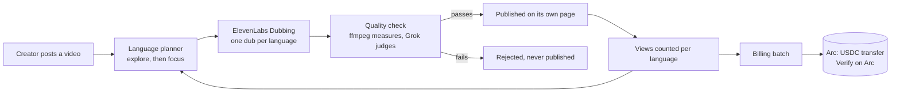

<div align="center">

# 🦜 Parrot

### Get your videos seen in every language.
**Parrot pays for the dubs. You pay only for the views they bring.**

  -111)  

**[Live demo](https://parrot-web.fly.dev)** · **[Creator dashboard](https://parrot-web.fly.dev/creator/maria)** · **[Get the extension](https://parrot-web.fly.dev/extension)**

</div>

---

A creator posts a video. Parrot dubs it into several languages with ElevenLabs, checks every dub
for quality, publishes each one on its own page, learns which languages the audience actually
watches, and from then on dubs only those. The creator pays a small amount for each view the
dubs earn, settled in USDC on Arc, and nothing for the languages that did not land.

Built for UBC 26. Main track: **Consumer Applications**. Chain: **Arc**. Bounties: **ElevenLabs**, **Grok Bot**.

## Why Parrot

- **Zero upfront cost.** Parrot pays ElevenLabs for every dub. A creator never buys a dub they
  might not use.
- **Pay for results.** Creators are charged **$1.00 per 1,000 counted views**, capped by a
  per-post budget (default $5.00).
- **It learns.** The planner explores eight languages over the first two posts, then focuses
  on the ones that pay for themselves.
- **Quality you can trust.** Every dub is measured with ffmpeg and judged by Grok. ElevenLabs
  never grades its own work, and a dub that does not pass is never published.
- **Payments you can verify.** A creator's charge is a real USDC transfer on Arc with a
  **Verify on Arc** link.
- **Meets creators where they are.** A Chrome extension adds **Dub this** under your own video
  on x.com, with a forecast before you commit.

## Live demo

**Try it: https://parrot-web.fly.dev**

| What | Link |
| --- | --- |
| Creator dashboard (start here, the demo creator is Maria) | https://parrot-web.fly.dev/creator/maria |
| Get the browser extension | https://parrot-web.fly.dev/extension |
| Chirp, the demo timeline | https://parrot-chirp.fly.dev |
| Backend API (health check) | https://parrot-backend.fly.dev/api/health |

Press **Dub into N languages** on an undubbed post, then **Send a demo audience** and watch the
views, the language plan and the payments move. To start the demo again from the beginning,
restart the backend.

## How it works



1. **Posts 1-2: explore.** Eight languages (biggest X audience first); the second post keeps the
   best half and swaps in new ones.
2. **Post 3 onwards: focus.** Up to three proven languages plus one test. A language is
   *proven* when its dubs average the views needed to pay for themselves (a 30-second dub costs
   $0.25, so 250 views); it is *dropped* after two misses or one clear miss, and retried every
   five posts.
3. **Money.** Parrot pays ElevenLabs per dub up front. The creator is charged per counted view
   in batches (hourly; every 12 seconds in demo mode), capped by the post budget and the
   creator's balance. The creator's own rate per 1,000 views, their "worth", is shown as their
   own number.

## On Arc: what moves on-chain

Everything below runs on **Arc testnet** (chain 5042002). Parrot uses Arc's own USDC
(`0x3600000000000000000000000000000000000000`) directly through its ordinary ERC-20 transfer,
so there is no custom contract to trust.

| Money flow | How it works |
| --- | --- |
| **A creator pays for views** (signed-in creator) | One USDC transfer per creator per billing batch, from the creator's own Arc wallet to Parrot's revenue address. Each charge has a **Verify on Arc** link to its transaction. |
| **The $1.00 welcome balance** | When someone signs up, a USDC transfer sends $1.00 from Parrot's Treasury to their new wallet. Once per person, at most 25 new wallets a day, and the Treasury always keeps a $1 reserve. |
| **Each user's wallet** | A real Arc address per signed-in user. Parrot creates and manages it, and keeps the key encrypted. The user never has to handle a key. |

**A payment is only ever counted once.** A creator is charged only for views Parrot has
counted, never more than the post's budget and never more than the wallet can pay (a small
reserve is kept back for Arc's network fee, which is paid in USDC from the same balance). Money
moves in batches, one payment per creator per sweep, so a busy post is one transaction and not
thousands. A dub's views are marked as billed **only after its payment confirms on Arc**, so a
failed payment is retried and a landed payment is not charged twice.

**Where to look.**
[Revenue address](https://explorer.testnet.arc.io/address/0x852Ad1a5A355553e0379D339D9AEdbAC8282d951)
(receives creator payments) ·
[Treasury](https://explorer.testnet.arc.io/address/0x373182286E60D2fe26b25816372a54D18d9A54AF)
(funds new wallets) ·
[USDC](https://explorer.testnet.arc.io/address/0x3600000000000000000000000000000000000000)

## Features

| Part | What it does |
| --- | --- |
| **Language planner and billing** | Explores languages, then focuses on the winners. Works out each creator's P&L and charges per counted view. Covered by 322 tests. |
| **Dubbing** | The ElevenLabs Dubbing API makes every dub, into 9 languages. |
| **Quality check** | Fail-closed. ffmpeg measures the audio; Grok hears the dub and scores whether it means the same thing as the original. ElevenLabs never grades its own dubs. |
| **Creator payments on Arc** | A signed-in creator pays from their own Arc wallet: one USDC transfer per billing batch, with a "Verify on Arc" link. |
| **Sign-up with a wallet** | Sign in with Google or email and get an Arc wallet with $1.00 of USDC to start. |
| **Creator dashboard** | Per-language views against break-even, what you owe, what the views are worth at your rate, the plan for your next post, and a payment history. |
| **Views** | Each dub has its own page and its views are counted there, with the viewer's country. |
| **Demo audience** | **Send a demo audience** lets you watch the numbers move. Its views are labelled Simulated. Each demo creator has a hidden taste per language that the planner has to discover. |
| **Grok** | Judges dub quality, reads requests and reply languages, and writes the dashboard summary. |

## The browser extension

The extension is the product surface. On x.com it adds **Dub this** under your own video, with
**Let Parrot choose** as the default so the planner picks the languages. After you click it, the
same strip fills in with the results: each language's views against the views it needs to pay
for itself, what you owe, what the views are worth at your rate, and what Parrot has learned.

```
npm run build:extension   # then Load unpacked: apps/extension/dist
```

Each dub lives on its own Parrot page and its views are counted there. A real dub of an x.com
video needs `yt-dlp`, `ffmpeg`, `ELEVENLABS_API_KEY` and `XAI_API_KEY`; the cost is about $0.50
per minute of video per language.

### The forecast, before you dub

Under your own undubbed video the strip shows **What Parrot expects**: per language, the
expected views (a range), what you would pay, and what the views are worth at your own rate,
plus the total, what Parrot pays to make the dubs, and an "if it takes off to 1.2M views" line.
For a creator Parrot knows nothing about, it is a funnel: your video's views × that language's
share of X's audience (DataReportal) × stated assumptions on reach (35%) and uptake (2%); 1.2M
views gives about 680 Spanish views. Once a creator has measured posts, languages Parrot has
already seen use their own results, and after dubbing the strip shows the forecast next to what
actually happened. A creator is charged only for views that happen, and never past their
per-post budget.

### Extension only, no Chirp

Set `CHIRP_ENABLED=false` and restart the backend. Nothing is seeded, Chirp's routes are closed,
and everything comes from the posts the extension reads from x.com.

## Tech stack

| Layer | Built with |
| --- | --- |
| Web app and demo timeline | Next.js 15, React 19, Tailwind CSS 4, TypeScript |
| Backend | Node.js, Express, TypeScript, zod |
| Chain | [viem](https://viem.sh) on Arc, native USDC |
| Dubbing | ElevenLabs Dubbing API |
| Quality and language | ffmpeg, Grok (xAI API) |
| Sign-in and wallets | Google OAuth, emailed one-time links, SQLite |
| Browser extension | Chrome Manifest V3, bundled with esbuild |
| Hosting | Fly.io |
| Tests | Vitest, 322 passing |

## Run it

```bash
npm install
cp .env.example .env
npm run dev:backend   # :8787
npm run dev:web       # :3100  (creator dashboard)
npm run dev:xclone    # :3200  (Chirp)
npm test
```

Open `/creator/maria`, press **Dub into N languages**, then **Send a demo audience** and watch
views, the plan and the payments move. Node 22.13 or newer is recommended.

Each capability switches on as its settings appear in `.env` (see `.env.example`):

| Setting | Turns on |
| --- | --- |
| `ELEVENLABS_API_KEY` | Real dubbing |
| `XAI_API_KEY` | Grok quality judging, request parsing and summaries |
| `PARROT_REVENUE_PRIVATE_KEY`, `PARROT_TREASURY_PRIVATE_KEY` | On-chain payments and the welcome balance |
| `WALLET_ENCRYPTION_KEY` + Google keys or an email sender | Sign-up with a wallet |
| `DAILY_DUB_SPEND_CAP_USD` | A daily ceiling on dub spending |

## Repository layout

| Path | Contents |
| --- | --- |
| `packages/shared` | Money maths, language planner, forecast, copy map, API contract |
| `apps/backend` | Campaigns, billing, views, quality check, sign-in and wallets |
| `apps/web` | Creator dashboard and the extension download page |
| `apps/x-clone` | Chirp, the demo timeline |
| `apps/extension` | The Chrome extension |

## Measuring impact

Alternate dubbed and undubbed posts across 5-10 real accounts for 2-3 weeks (10+ posts each, since
X views are noisy). Success is total views on dubbed posts at least 1.3× undubbed. Track views
per language, engagement, follower change and net P&L.

## Bounties

- **Arc:** creators pay for views with real USDC transfers on Arc from their own per-user
  wallets, one batched payment per creator with a Verify on Arc link; new wallets are funded by
  an on-chain Treasury transfer. Contract-free, using Arc's native USDC. The
  [On Arc](#on-arc-what-moves-on-chain) section lists every flow.
- **ElevenLabs:** the Dubbing API makes every dub. It is central to the product, not an add-on.
- **Grok:** the xAI API judges dub quality, reads requests and reply languages, and writes the
  creator summaries.
